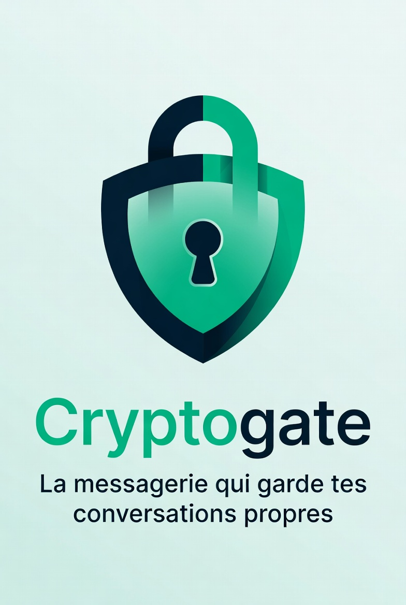

<p align="center">
  
</p>

<h1 align="center">Secsy Chat</h1>

<p align="center">
  Messagerie instantanée <b>chiffrée</b> en Python : serveur TCP multi-thread, client en terminal (TUI), canaux, messages privés chiffrés de bout en bout, intégrité signée.
</p>

> Projet intégratif **UE14 – Intégration de la sécurité 1** (HELMo, Bachelier en informatique, orientation Sécurité des systèmes).
> Le projet a ensuite fait l'objet d'un **audit de sécurité** : les failles trouvées et corrigées sont documentées dans [docs/AUDIT_SECURITE.md](docs/AUDIT_SECURITE.md).

## Ce que fait le projet

- **Canaux publics et privés** (secret protégé par Argon2), création, entrée, sortie, expulsion (temporaire ou définitive) et suppression par le créateur.
- **Messages privés** entre utilisateurs, chiffrés de bout en bout (seul le destinataire peut les lire).
- **Historique** : les 20 derniers messages du canal et des messages privés sont restaurés à la connexion.
- **Interface en terminal** (TUI) avec liste des canaux et des utilisateurs connectés.
- Un assistant IA (Gemini) en **bonus optionnel**, isolé dans un seul fichier (voir [Assistant IA](#assistant-ia-optionnel)).

## Sécurité en un coup d'œil

| Couche | Mécanisme |
|---|---|
| Mots de passe | Hachage **Argon2** côté serveur |
| Clé de transport | **Diffie-Hellman** (groupe RFC 3526, 2048 bits), établi *avant* tout identifiant |
| Transport client ↔ serveur | **AES-256-GCM** (le type d'échange est authentifié par GCM) |
| Contenu des messages | Clé **ChaCha20-Poly1305** unique par message, chiffrée avec la clé publique **RSA-2048** du destinataire |
| Intégrité et authenticité | Somme **SHA-256** (émetteur, destinataire, horodatage, charge) signée en **RSA**, vérifiée par le serveur **et** le destinataire |
| Authentification | Mot de passe **+** signature RSA d'un horodatage (clé publique enregistrée à la première connexion) |
| Protocole | En-tête de 11 octets, schémas **JSON Schema** pour chaque message, instruction et évènement |

**Ce que le serveur peut lire.** Les messages privés sont chiffrés avec la clé publique du destinataire : le serveur ne peut pas les lire. Les messages de canal sont chiffrés avec la clé du canal, que le serveur génère, stocke et distribue aux membres (c'est le schéma imposé par l'énoncé) : le serveur *peut* donc les déchiffrer. Dans les deux cas, il vérifie les signatures avant de stocker et de relayer.
Détails : [docs/PROTOCOLE.md](docs/PROTOCOLE.md). Limites connues et écarts : fin de [docs/AUDIT_SECURITE.md](docs/AUDIT_SECURITE.md).

## Installation

Prérequis : **Python 3.10+**.

```powershell
git clone https://github.com/CryptoGate-hub/secsy-chat.git
cd secsy-chat
python -m venv .venv
.\.venv\Scripts\Activate.ps1          # Linux / macOS : source .venv/bin/activate
pip install -r requirements.txt
```

**Interface TUI.** Le client utilise la bibliothèque `secsychat-tui` fournie par HELMo dans le cadre du cours (elle n'est pas redistribuée ici). Installe-la depuis la source fournie par l'école :

```powershell
pip install <chemin vers secsychat_tui-0.1.0-py3-none-any.whl>
python -c "import secsychat_tui; print('TUI OK')"
```

## Lancement

```powershell
# Terminal 1 : le serveur (port 4000)
python server.py

# Terminal 2 et 3 : deux clients
python client.py 127.0.0.1 4000 alice
python client.py 127.0.0.1 4000 bobby
```

À la **première connexion** d'un pseudo (3 à 20 caractères : lettres, chiffres, `_`, `-`, `.`), une paire de clés RSA est créée dans `<pseudo>.key` et le compte est créé avec le mot de passe saisi (8 caractères minimum, sans écho).
Conserve ton fichier `.key` : sans lui, le compte n'est plus accessible (voulu). Ne le partage jamais et ne le commite jamais (il est dans le `.gitignore`).

## Commandes

| Commande | Effet |
|---|---|
| `/commands` | Liste des commandes |
| `/users`, `/status` | Utilisateurs connectés, canal actif |
| `/create <nom> [mdp]` | Crée un canal (privé si un mot de passe est donné, 6 caractères minimum) |
| `/join <nom> [mdp]` | Rejoint un canal |
| `/leave` | Quitte le canal actuel (retour dans `#general`) |
| `/kick <pseudo> [secondes]` | Expulse un membre (créateur du canal uniquement) |
| `/delete <nom>` | Supprime un canal (créateur uniquement) |
| `/pm <pseudo> <message>` | Message privé chiffré de bout en bout |

## Structure

```
secsy-chat/
├── server.py          # Serveur TCP multi-thread
├── client.py          # Client TUI
├── ai_assistant.py    # Assistant IA Gemini (optionnel)
├── common/
│   ├── security.py    # Cryptographie (Argon2, DH, AES-GCM, ChaCha20, RSA, SHA-256, NanoId)
│   ├── network.py     # Sockets : en-tête de 11 octets
│   ├── database.py    # Accès SQLite
│   ├── data.py        # Utilisateurs, canaux, messages
│   ├── message.py, statement.py, event.py, exchange.py   # Types d'échanges + schémas JSON
└── docs/              # Documentation technique et audit de sécurité
```

## Assistant IA (optionnel)

`/ia <question>` et `/ia pro <question>` interrogent Gemini. **Attention : ce message part en clair vers Google et sort donc du chiffrement de bout en bout.** Le client l'indique avant le premier usage, et seul le message adressé à l'IA est envoyé (jamais l'historique du canal).

```powershell
$env:GEMINI_API_KEY = "ta_clé"    # clé gratuite : https://aistudio.google.com/api-keys
```

Sans clé, l'IA se désactive toute seule. Pour la couper définitivement : `AI_ENABLED = False` dans `ai_assistant.py`.

## Limites connues

Projet pédagogique, à ne pas utiliser en production. En particulier : Diffie-Hellman non authentifié (attaque de l'homme du milieu active possible), pas de limitation des essais de mot de passe, et une instruction de l'énoncé (`UPDATE_USER`) non implémentée. Liste complète dans [docs/AUDIT_SECURITE.md](docs/AUDIT_SECURITE.md).
